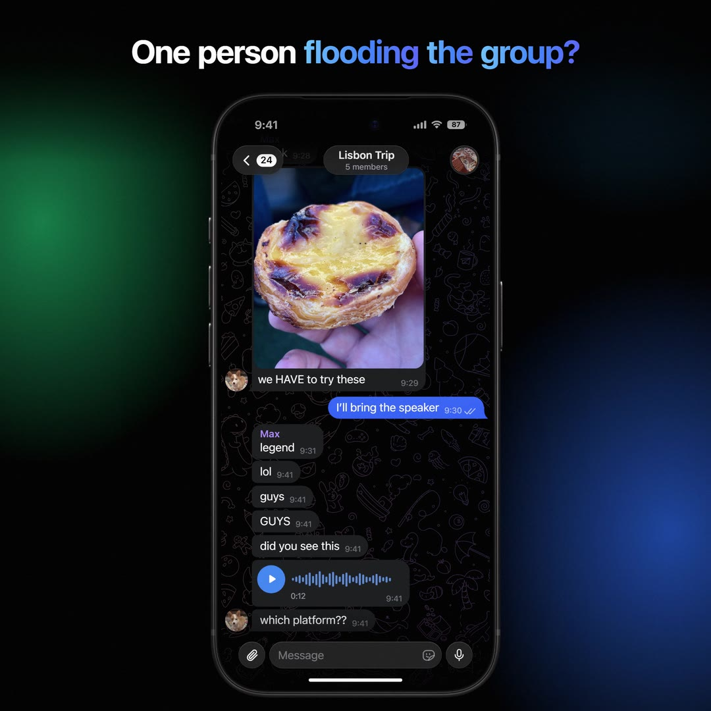
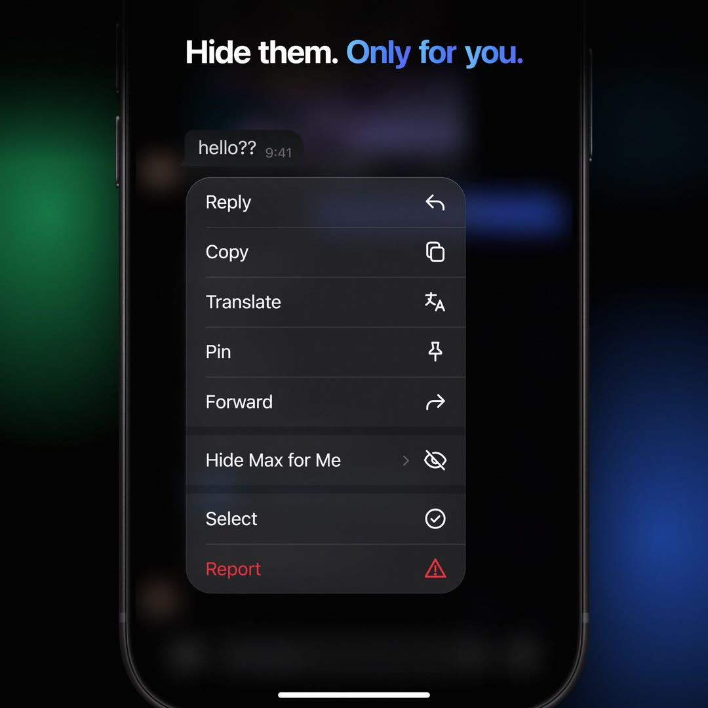
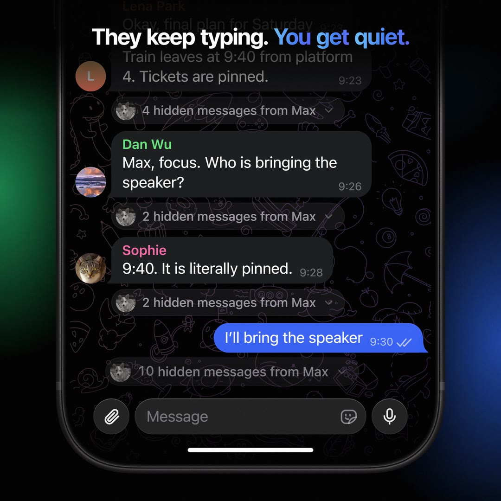
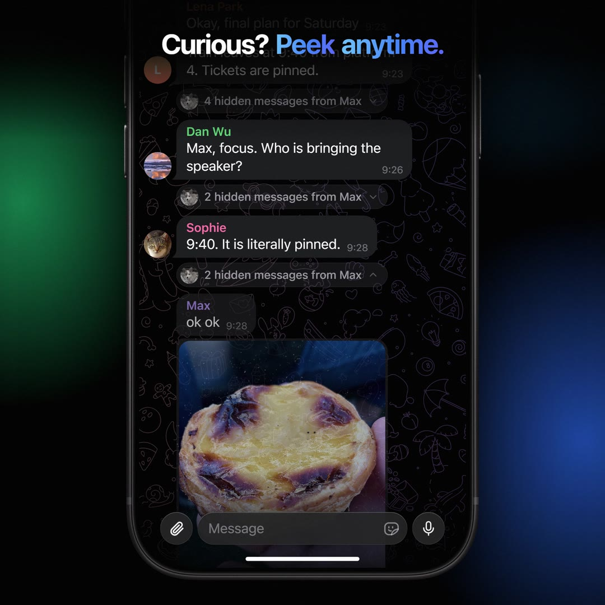
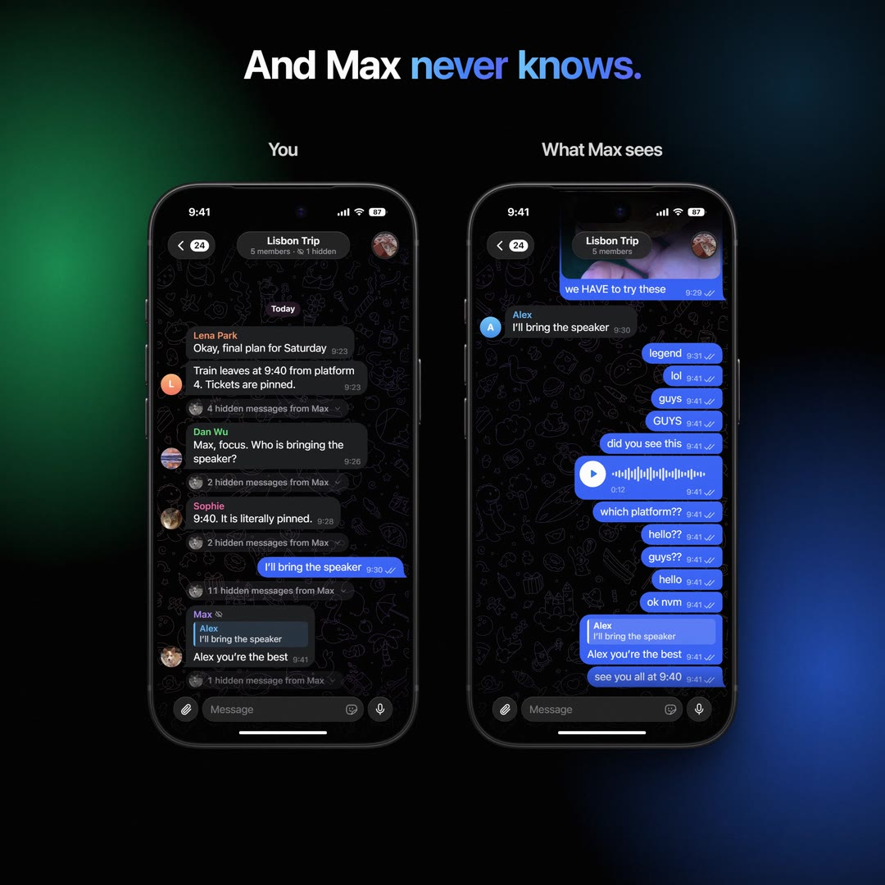
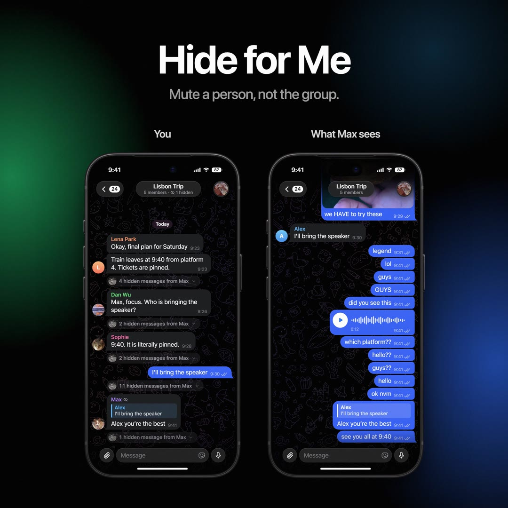

# Hide for Me

**Mute a person, not the group.** A feature proposal for Telegram, with a working prototype.

In a busy group, one person can drown out everyone else. Today the only way out is to mute or leave the whole group. **Hide for Me** lets you stop seeing **one member's messages in one group, only on your device**, and nobody is told.

<p>
  
  
  
  
  
  
</p>

Demo video: [`video/hide-for-me.mp4`](video/hide-for-me.mp4) (28.5 s, 1920 × 1920, 60 fps, with sound), rendered frame by frame from the working prototype.

## What it does

- **Long-press any of their messages → Hide Max for Me →** *For 1 Hour*, *Until Tomorrow* or *Always*. It sits in the menu next to Reply, Pin and Forward, like Mute does for chats.
- **Their messages dissolve into Telegram's spoiler dust and fold away.** Consecutive messages become one quiet row: *"4 hidden messages from Max"*.
- **They keep typing, you get quiet.** New messages from them join the row and the counter ticks up. No notification, no sound, no unread badge.
- **Replies to you and mentions still come through**, marked with a small eye-slash so it's clear why you see them.
- **Peek anytime.** Tap a row and the messages unfold in place, dimmed, out of the dust. Tap again to fold them.
- **You always know.** The header reads *"5 members · 1 hidden"*, so the group never seems to have gone quiet by mistake.
- **Undo** comes with Telegram's countdown toast; timed rules end on their own.
- **Nobody else is affected and nobody is told.** Max's phone shows the chat exactly as before; his messages are delivered and read as usual.

## How it would work in Telegram

It is a client-side view filter, so it needs no change to how messages are sent, stored or delivered:

- A rule is `{ peer, user, until | forever, showReplies }`, kept with your local chat settings. Optionally it can sync between your own devices the way other personal settings do; it is never visible to the group or the hidden person.
- Messages from a hidden user are still received and stored, so peeking or un-hiding is instant and nothing is lost.
- The message list folds runs of hidden messages into one placeholder; unread counters and notifications skip them, except messages that reply to you or mention you.
- No new privacy surface: unlike blocking, nothing can be inferred by the other side.

## The prototype

```bash
npm install
npm run fetch-pattern   # optional: Telegram's background pattern (see below)
npm run dev             # http://localhost:5174
```

Right-click or long-press one of Max's messages. Buttons under the phone make Max keep typing, or reply to and mention you. Rules persist across reloads.

The interface is a web recreation of Telegram for iOS 26 (dark theme, Liquid Glass), built at the iPhone's real point sizes and measured against screenshots of the app: 44 pt bar capsules, 40 pt input bar, the measured bubble and glass colours, and the default wallpaper's four-colour gradient fitted to a device screenshot. The feature logic is real and tested; only the other group members are scripted.

| Piece | Where |
| --- | --- |
| Rules: hide, unhide, Undo, durations, expiry, persistence | `src/hide/store.ts` |
| What you see: folding runs into rows, peeking, the reply/mention exception, unread and notification filters | `src/hide/collapse.ts` |
| Chat screen, menu, rows, toast, spoiler dust, wallpaper | `src/phone/` |
| The video take and its renderer | `src/stage/Stage.tsx`, `video/render-source/` |

## Tests

```bash
npm run test:unit   # 19 tests: folding, exceptions, durations, expiry, persistence
npm run test:e2e    # 6 Playwright tests: menu, long press, hide, header, Undo, peek, new messages, replies, reload
```

## Rendering the video

```bash
npm run render
```

The renderer opens `/stage` in headless Chromium on a virtual clock and captures every frame of the real app, then `sound.mjs` adds the soundtrack. The music and interface sounds are synthesized from oscillators and noise (no samples), timed to cues the take records, so every pop and tap lands on its frame.

## Assets

- **Photos** in `public/photos/` are from Wikimedia Commons under Creative Commons Attribution licences; see [`public/photos/CREDITS.md`](public/photos/CREDITS.md).
- **Telegram's background pattern** (from Telegram Web K, GPL-3.0) is not included; `npm run fetch-pattern` downloads it. Without it the prototype draws a stand-in pattern.
- **SF Pro** and the **iPhone 18 Pro** bezel come from Apple Design Resources, whose licence does not allow redistribution, so they are not included. Put them in `public/apple/` (`fonts/SF-Pro.ttf`, `fonts/SF-Pro-Rounded-*.otf`, `bezel-iphone-18-pro-black.png`) to match the video; without them the prototype uses Inter and a drawn frame.

---

An independent concept. Not affiliated with or endorsed by Telegram.
